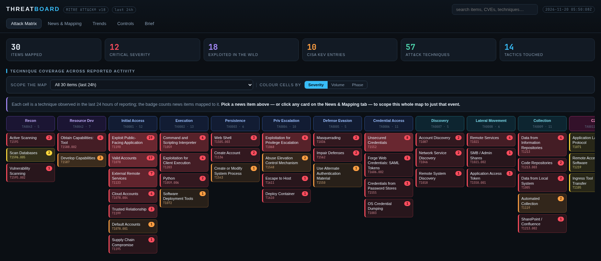
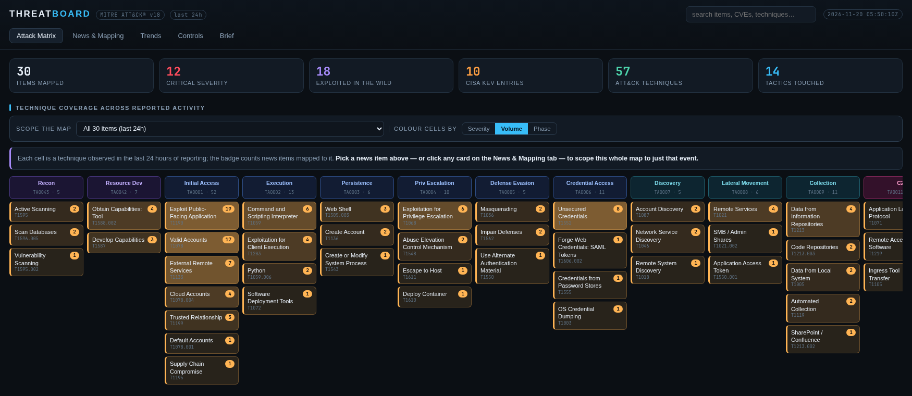
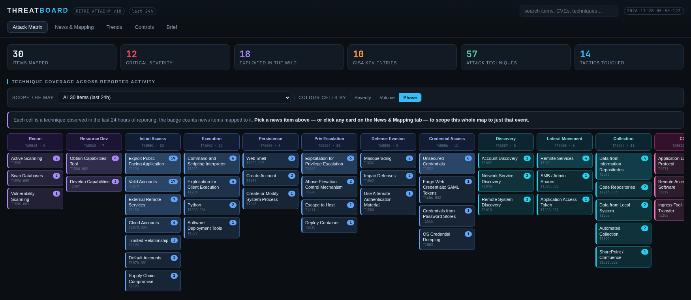
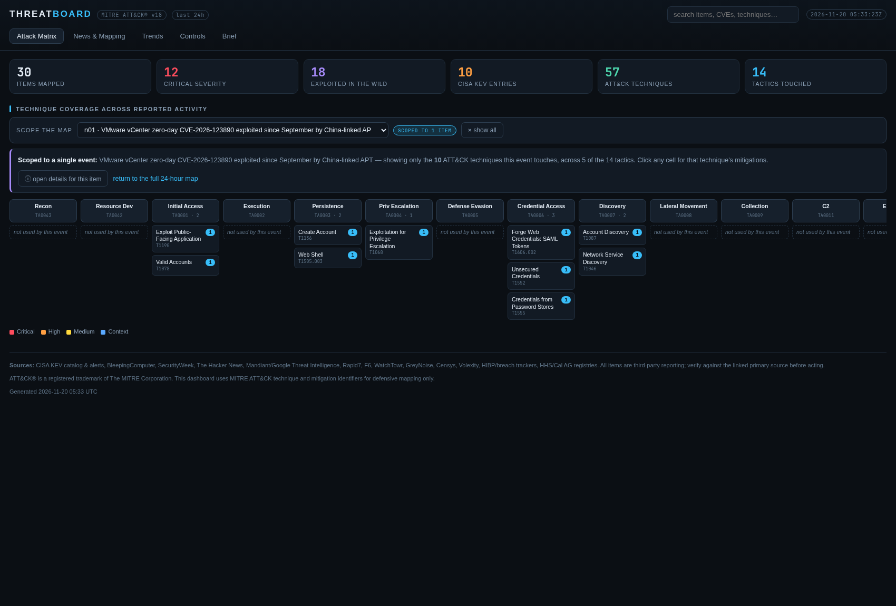
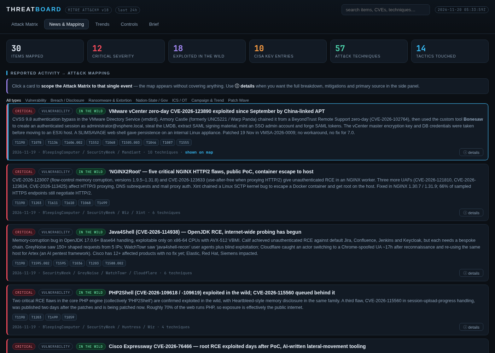

# THREATBOARD

A single-file MITRE ATT&CK® cyber-news dashboard. It takes a day of security
reporting and turns it into a navigable **technique → tactic → mitigation**
map, so you can answer three questions in one place:

1. What actually happened in the last 24 hours?
2. Which ATT&CK techniques does that activity touch?
3. What controls would have blocked or reduced it?

No build step, no dependencies, no backend. One HTML file you can open
directly or serve from anything.



---

## Quick start

```bash
git clone https://github.com/<owner>/mitre-threatboard.git
cd mitre-threatboard

./run.sh start          # http://127.0.0.1:8899/index.html
./run.sh status
./run.sh stop
```

Or skip the script entirely — it is a static page:

```bash
python3 -m http.server 8899
# or just open index.html in a browser
```

`PORT=9000 ./run.sh start` if 8899 is taken.

---

## What it does

**Five views, one dataset.**

| View | Purpose |
|---|---|
| **Attack Matrix** | All 14 tactics as columns; every technique reported in the window as a cell with an event count. |
| **News & Mapping** | One card per reported event: severity, type, technique IDs, primary source. |
| **Trends** | Where the activity concentrates — by tactic, activity type, and technique. |
| **Controls** | Every ATT&CK mitigation (M-code) that the mapped activity points at, ranked by coverage, with NIST SP 800-53 families. |
| **Brief** | A written executive brief generated from the same data. |

**Scoping.** Click any news card and the entire matrix narrows to that single
event — showing only the techniques it touches and marking untouched columns
*"not used by this event."* The side panel never opens on its own; use
**ⓘ details** on a card, or the map's own button, when you want the full
breakdown. Deep links are shareable:

```
#item=n01              scope the map to one event
#item=n01&tab=feed     ...and land on the news view
#cb=vol                start in volume colour mode
```

**Drill-down.** Click a technique cell for its mitigations, the events that
use it, and its kill-chain phase. Click a column header to filter the feed by
tactic.

---

## The colour scheme

Colour carries meaning, not decoration. Two independent axes, deliberately in
opposite temperature ranges so they never collide:

**Cool = kill-chain phase** (column headers and technique chips)

| Phase | Tactics | Colour |
|---|---|---|
| Pre-attack | Reconnaissance, Resource Development | violet |
| Intrusion / foothold | Initial Access → Credential Access | blue |
| Post-compromise | Discovery, Lateral Movement, Collection | cyan |
| Impact | C2, Exfiltration, Impact | magenta |

**Warm = severity** (matrix cell tint and badge) — red critical, orange high,
yellow medium. Tint intensity deepens with the number of events using that
technique, so severity and volume read in a single glance.

You can switch the cell axis with **Colour cells by → Severity / Volume /
Phase**:

| Mode | Encodes |
|---|---|
| **Severity** (default) | Worst severity of the events using the technique |
| **Volume** | How many events use it — a single-hue brightness ramp |
| **Phase** | The technique's kill-chain phase |

Elsewhere: activity-type chips are colour-coded (vulnerability, ransomware,
breach, nation-state, ICS, trend, patch); controls are tiered by coverage rank;
trend bars are coloured by phase and category.



---

## Data model

Everything is embedded in `index.html` in three tables, immediately after
`<script>`:

```js
const TACTICS = [{id:"TA0001", n:"Initial Access", s:"Initial Access"}, ...];
const TECHS   = { T1190:{t:"TA0001", n:"Exploit Public-Facing Application"}, ... };
const TECH_MIT= { T1190:["M1051","M1048","M1050","M1016","M1030"], ... };
const MIT     = { M1051:{n:"Update Software", nist:"SI-2, CM-6, RA-5"}, ... };
const ITEMS   = [{id:"n01", d:"2026-11-19", sev:"crit", cat:"vuln",
                  title:"...", src:"...", url:"...", tch:["T1190", ...],
                  sum:"...", act:["..."], ctl:["..."]}, ...];
```

To refresh the dashboard, replace `ITEMS` and keep `tch` referencing IDs that
exist in `TECHS`. The validator below enforces that.

Field notes:

- `sev` — `crit` | `high` | `med` | `info`
- `cat` — `vuln` | `breach` | `ransom` | `nation` | `ics` | `trend` | `patch`
- `tch` — ATT&CK technique IDs; drives every count, filter and colour
- `act` — attribution or actor notes
- `ctl` — plain-language, item-specific controls

---

## Example output

`docs/brief-2026-11-20.md` is a full brief produced from this dataset — the
kind of document the Brief tab renders, expanded with per-item citations. It
shows the intended end state: news → technique → control, with caveats stated
rather than buried.

---

## Validating

```bash
node tools/validate.mjs
```

Checks referential integrity end to end:

- every technique referenced by an item exists in `TECHS`
- every technique maps to a valid tactic
- every technique has at least one mitigation, and every mitigation exists
- every `M####` mentioned in control prose actually exists
- no duplicate item IDs or duplicate techniques within an item
- each item cites at least three techniques and has controls

Exits non-zero on failure, so CI catches a broken data edit before it ships.
See `.github/workflows/validate.yml`.

---

## Scope and limitations

**This is a snapshot, not a feed.** The bundled dataset is a point-in-time
capture of public reporting from 20 November 2026, 05:00 UTC. It does not
update itself. Replacing `ITEMS` is a manual (or separately automated) step —
the app has no network access of its own.

**All content is third-party reporting.** Verify against the linked primary
source before acting on anything, especially breach counts and attribution.

**Severity reflects reported impact, not your exposure.** NGINX2Root only
matters if HTTP/2 is enabled on a reachable listener; an Apache Axis flaw only
matters if the legacy Axis surface is present. Version counts are not exposure.

**The control ranking is mechanical.** Coverage is computed from ATT&CK's
technique→mitigation mappings, which under-map cross-cutting controls —
`M1053 Data Backup` scores low despite being central to ransomware defence.
Treat the ranking as an input to judgement, not a verdict.

**Attribution is provisional** throughout, and the dashboard says so per item.

**No secrets, no telemetry.** The app makes no outbound requests; source links
open in a new tab only when clicked.

---

## Screenshots

| | |
|---|---|
|  |  |
|  |  |

---

## Licence

MIT — see [LICENSE](LICENSE).

MITRE ATT&CK® is a registered trademark of The MITRE Corporation. Technique
and mitigation identifiers are used here for defensive mapping only. This
project is not affiliated with or endorsed by MITRE.